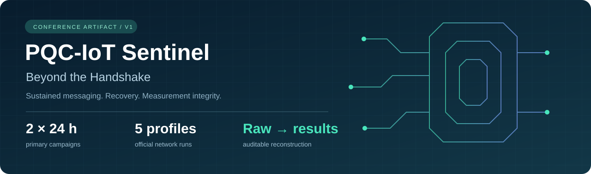
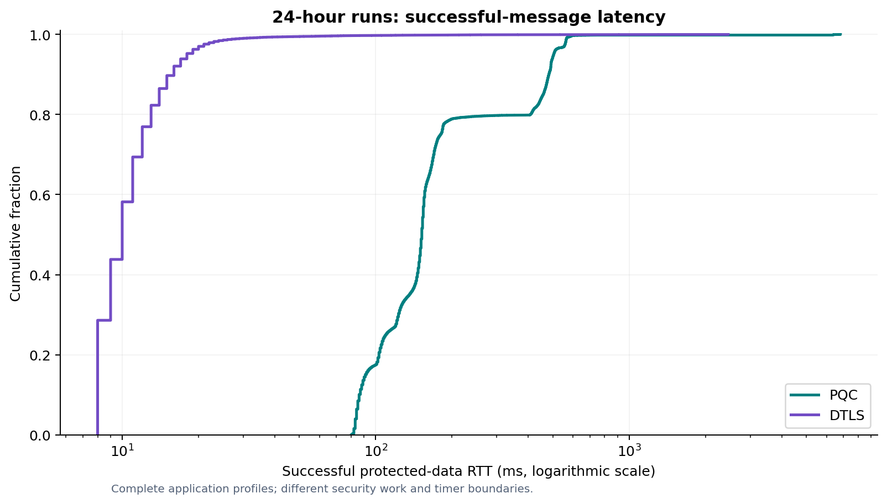
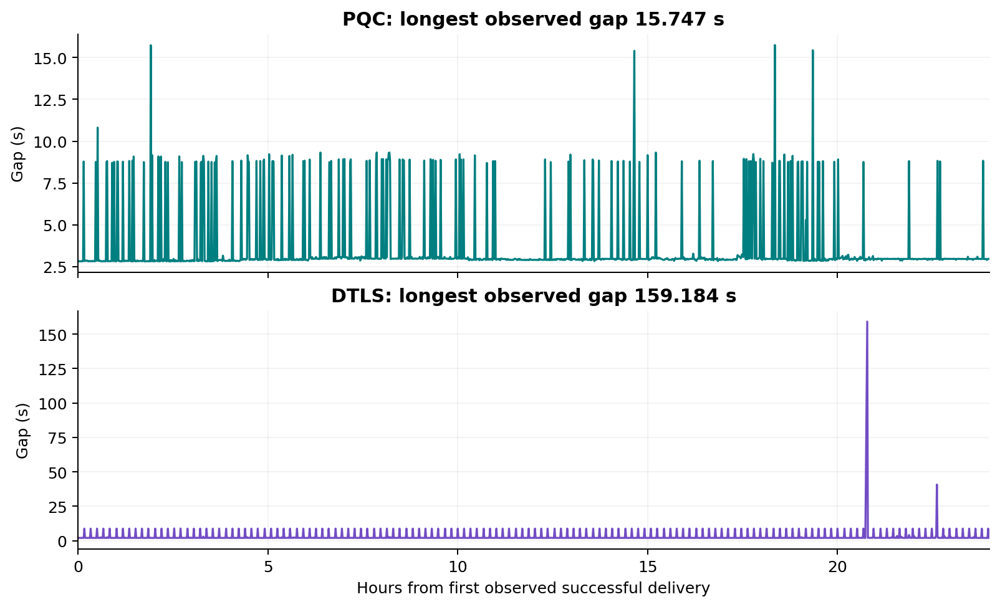
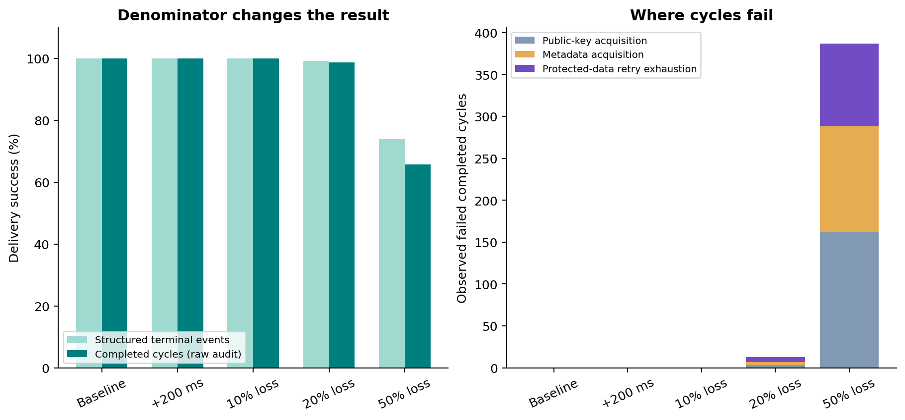

<p align="center"></p>

<p align="center"><b>Conference Version 1 · BL602 / RISC-V · CoAP / UDP · Kyber-derived PQC · DTLS 1.2</b></p>

<p align="center"><a href="artifact/REVIEWER_GUIDE.md">Reviewer guide</a> · <a href="artifact/REPRODUCIBILITY.md">Reproduce results</a> · <a href="evidence/README.md">Browse evidence</a> · <a href="source/README.md">Source code</a> · <a href="https://pqcsecrity.live/evidence">Live website</a></p>

# Beyond the Handshake

**A 24-Hour Study of Post-Quantum Messaging and DTLS on BL602.** This repository brings the Version 1 experimental evidence, sanitized source, analysis, figures, and reproduction instructions together. It is separate from the original development repository.

The study examines sustained messaging, session recovery, delivery continuity, and measurement completeness on constrained IoT hardware. Its central result is an operational comparison of two complete applications with different security contracts. The observed latency difference cannot be attributed to key-establishment cryptography alone.

> **Manuscript status:** the final *Beyond the Handshake* conference PDF was not present in the supplied archives. The two PDFs in [paper/historical/](paper/historical/) are explicitly labeled historical reports. This repository does not present either as the final manuscript.

## Start here

| Goal | Open |
|---|---|
| Review the contribution and evidence in 10 minutes | [Reviewer guide](artifact/REVIEWER_GUIDE.md) |
| Find the original record behind a claim | [Claim-to-evidence matrix](artifact/CLAIM_EVIDENCE_MATRIX.md) |
| Reproduce counts, timing, retry and packet audits | [Reproducibility guide](artifact/REPRODUCIBILITY.md) |
| Download raw logs and PCAPs | [Evidence bundles](evidence/bundles/) and [bundle manifest](artifact/BUNDLES.json) |
| Inspect firmware, host tools and dashboard source | [Sanitized source](source/project/) |
| Understand limitations before interpreting numbers | [Measurement notes](docs/MEASUREMENT_NOTES.md) and [security scope](docs/SECURITY_SCOPE.md) |

## Two 24-hour campaigns

| Observation | PQC application | DTLS application |
|---|---:|---:|
| Host capture duration | 86,400.172 s | 86,400.820 s |
| Successful sender outcomes | 32,790 | 42,346 |
| Structured failed sender outcomes | 0 | 2 |
| Parsed receiver successes | 32,789 | 42,346 |
| Successful data RTT, median | 152 ms | 10 ms |
| Successful data RTT, P95 | 503 ms | 18 ms |
| Successful data RTT, P99 | 566 ms | 29.55 ms |
| Longest observed delivery gap | 15.747 s | 159.184 s |
| Successful handshakes, sender / receiver | N/A | 143 / 143 |
| Raw handshake-call errors, sender / receiver | N/A | 29 / 2 |

The DTLS structured handshake-failure totals remain zero despite the raw call errors. The reproduction script recovers those errors from the serial logs. Successful-message RTT therefore needs to be read alongside recovery and delivery continuity, with separate denominators.





These are descriptive results from one campaign per configuration. Individual messages are not independent campaign repetitions. See [machine-readable primary results](results/primary_24h.csv) and the [raw-data reconstruction](results/reproduced_summary.json).

## Five official PQC network profiles

| Condition | Delivered / 1,000 structured outcomes | Completed cycles, raw audit | Completed-cycle delivery | RTT median / P95 |
|---|---:|---:|---:|---:|
| Baseline | 1,000 | 1,000 | 100.00% | 130 / 548 ms |
| +200 ms forward delay | 1,000 | 1,000 | 100.00% | 337 / 748 ms |
| 10% random loss | 1,000 | 1,000 | 100.00% | 129.5 / 6,535.35 ms |
| 20% targeted loss | 991 | 1,004 | 98.71% | 132 / 6,912 ms |
| 50% targeted loss | 739 | 1,126 | 65.63% | 546 / 13,300.40 ms |

At 20% and 50% loss, raw logs reveal respectively **4 and 126 metadata failures** omitted from the structured terminal denominator. At 50% loss, public-key and metadata acquisition account for **288 of 387 observed failed completed cycles**. The original sealed summaries remain intact; the completed-cycle correction is an additional derived analysis.



PCAP reconstruction independently checks forwarding counts against the archived tcpdump text. Capture-wide forward missing fractions are about 9.55%, 19.95%, and 50.54% in the loss conditions. A one-packet difference at the delayed capture boundary is documented separately. The [experiment index](artifact/EXPERIMENT_INDEX.md) identifies official runs, excluded diagnostic attempts, original seal hashes, and corrected retry semantics.

## What each application does

| Aspect | PQC application | DTLS operational reference |
|---|---|---|
| Key establishment | Fresh Kyber-derived 512-parameter KEM per cycle | ECDHE P-256; established session reused |
| Authentication | Pinned receiver key plus provisioned sender HMAC | ECDSA P-256 server certificate; no client certificate |
| Payload protection | HKDF-SHA-256 and AES-256-CCM | DTLS 1.2 AES-256-CCM records |
| Acceptance state | Persistent sequence/freshness; source orders persistence before ACK | No equivalent persistent application commit |
| ACK behavior | Request-bound authenticated application ACK | Application reply over the DTLS channel |
| Timer interpretation | Data exchange excludes key/metadata retrieval and preparation | Successful exchanges on established sessions |

The recorded plaintext is 22 bytes. The PQC protected application payload is 874 bytes, and its minimal CoAP UDP payload is 890 bytes. These are different boundaries from DTLS CoAP length and estimated record length.

The conservative algorithm description is **Kyber-derived, 512-parameter**. Historical source strings use “ML-KEM-512”; the artifact does not establish FIPS 203 conformance, module certification, a formal composition proof, or physical resistance. See [security scope](docs/SECURITY_SCOPE.md).

## Reproduce without hardware

Requires Python 3.10+ and roughly 700 MB of free space. Run from the repository root:

```bash
python3 analysis/verify_integrity.py
python3 analysis/extract_evidence.py
python3 analysis/reproduce.py --check
```

This verifies the published hashes, extracts the public bundles, reconstructs the results from raw logs and captures, checks official network seals, and compares against the committed summary. Figure rendering is a separate optional step using Matplotlib; see [the full guide](artifact/REPRODUCIBILITY.md).

The [host-check report](artifact/HOST_CHECKS.json) records the actual local software checks. It does not establish a BL602 SDK build, successful physical flashing, arbitrary power-cut atomicity, target entropy quality, or cryptographic conformance. Optional dashboard tests are labeled as skipped when their dependencies are absent.

## Evidence, integrity and provenance

- [Nine public bundles](artifact/BUNDLES.json): the primary logs, five official network runs with PCAPs, DTLS memory characterization, and excluded/diagnostic attempts.
- [Original source](source/project/) and [downloadable sanitized source ZIP](source/PQC_IoT_SENTINEL_V1_PUBLIC_SOURCE.zip), with provisioning and build instructions.
- [Screenshots](evidence/screenshots/README.md) and [historical reports](paper/README.md) as supporting material; raw logs control numerical interpretation.
- [SHA-256 manifest](artifact/SHA256SUMS.txt), [redaction ledger](artifact/SANITIZATION.json), and [excluded build-file identities](artifact/EXCLUDED_PRIVATE_BUILD_FILES.json).
- [Resource records](evidence/resources/README.md) and [firmware provenance limits](artifact/FIRMWARE_PROVENANCE.md).

Public copies redact credential strings printed by the DTLS Wi-Fi driver and remove private-key/provisioning material from source. The ledger identifies every changed evidence file by original and public hash. Historical manifests are retained as historical records; the public manifest describes the actual published files.

## Scope and limits

Version 1 has one main campaign per configuration, one board pair, one payload size, different application security semantics, no matched DTLS impairment campaign, unequal memory-observation durations, and incomplete historical source-to-binary provenance. The evidence does not establish energy consumption, flash lifetime, multi-device scale, or physical attack resistance. Future matched-baseline and repeated campaigns belong to a subsequent research version.

**Live evidence portal:** [pqcsecrity.live/evidence](https://pqcsecrity.live/evidence). The website provides presentation and navigation; archived evidence and scripts define this release's reported results.
