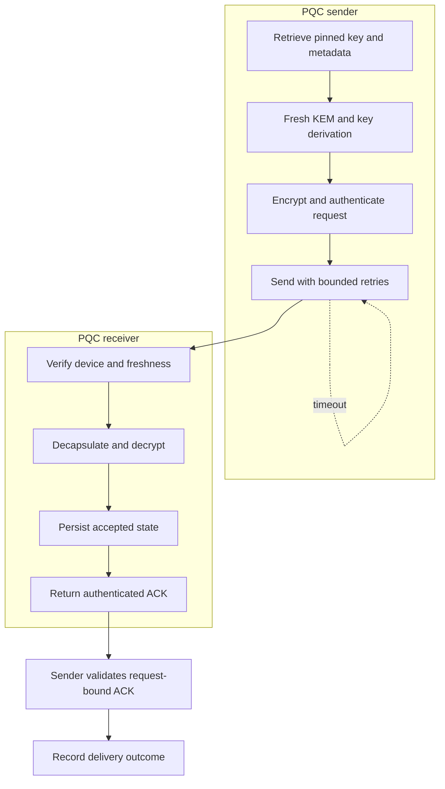

# Evaluated architecture

The PQC application protects a message at the application layer. The DTLS reference protects CoAP exchanges through a reused DTLS channel. They share a hardware class and plaintext length, while their security work and timing boundaries differ.

The persistence-before-ACK relationship is supported by inspected source ordering and simulated-storage tests. Physical crash atomicity across arbitrary power interruption is not established.

The primary PQC data RTT starts after preparation, public-key/metadata retrieval, encapsulation, key derivation and encryption. Local stage timers and protected-data RTT are not interchangeable with full-cycle latency. The DTLS reference reuses established sessions and lacks equivalent provisioned sender authentication and persistent application acceptance semantics.

In the secondary network experiments, a Raspberry Pi forwards traffic from the sender-side `ap0` network to the receiver-side `wlan0` network. Captures observe both forwarding sides. The loss conditions affect the forward path; reverse-path counts agree in the selected captures. Configured qdisc loss and capture-derived missing fractions are reported separately.

See [measurement notes](MEASUREMENT_NOTES.md) for denominator/timer boundaries and [the claim matrix](../artifact/CLAIM_EVIDENCE_MATRIX.md) for supporting records.
