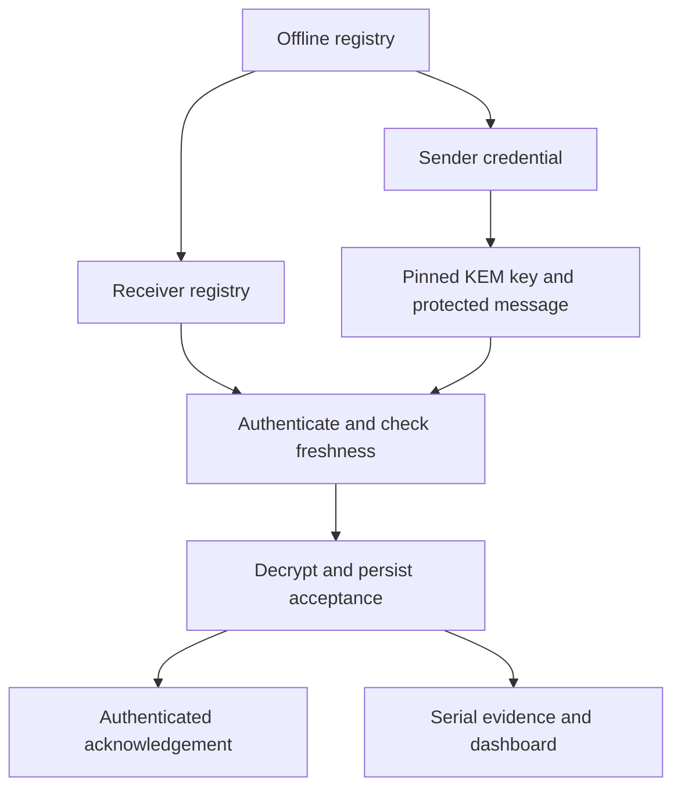

# Project analysis and update record

Release 2.0.0, 12 September 2026. This assessment covers the supplied project and
the changes in this archive. It is a software review and host validation report,
not a certification or a claim that a BL602 image was built here.

## Architecture and operating flow

The system is a BL602 research testbed with an encrypted CoAP application, an
offline two-device HMAC registry, serial telemetry, Splunk integration, a local
React/FastAPI dashboard and separate measurement tools. The PQC receiver owns
one persistent KEM keypair. Each sender pins that receiver's public-key SHA-256
fingerprint, encapsulates a fresh shared secret for every message, derives a
32-byte AES key with HKDF-SHA-256, encrypts with AES-256-CCM and adds a per-device
HMAC-SHA-256 tag.

The receiver validates framing and credentials, verifies HMAC before the expensive
KEM operation, enforces freshness, decrypts and durably records acceptance before
sending an authenticated acknowledgement. The next request uses a fresh KEM
encapsulation. This is an application-specific protocol over UDP/CoAP, not
post-quantum TLS and not a drop-in interoperable standardized IoT security stack.

## Problems found and how this release handles them

| Original issue | Updated behavior | Verification or limit |
|---|---|---|
| Fingerprint generator replaced the advanced profile with old macros | Patches only fingerprint/IP/discovery/optional ID; preserves profile 4 and enrolled identity | Lifecycle tests provision Sender B and verify preserved macros |
| Raw fixed-address sender flash sector erased for every message; save failures ignored | SDK-managed EasyFlash, CRC/readback, reserved blocks of 256 sequences, failure latch | Actual sender storage functions tested with simulated flash |
| Receiver ignored replay-state save failures | No successful acceptance/ACK after save failure; receiver task halts | Actual persistence helper tested for write and stale-read failures; physical power loss not tested |
| Stored disabled slots could stay disabled after enrollment | Reconcile compiled credentials at boot by ID and generation | Host state tests cover disable/re-enable and rotation |
| Rotation lacked a persistent generation namespace | Generation included in HMAC/AAD-protected wire header and persistent state | Lower-generation restoration rejected by application logic |
| Plain `OK` ACK could be forged | HMAC ACK binds to the full request's authentication tag through a separate domain | Shared ACK input/layout checks; hardware network path pending |
| Lost ACK caused a valid retransmission to look like a new replay | Most recent identical authenticated request receives another ACK without redelivery | Last request tag persisted with the per-sender counter |
| RNG failures were logged but callers could continue | Seed/generation errors propagate, KEM wrappers latch upstream randombytes failures and clear output | Native fault tests plus 100 scalar-core KEM round trips |
| CoAP extended fields wrapped; URI truncation and empty payload markers accepted | Wide option arithmetic, strict bounds, unsupported critical-option rejection, no URI truncation | Native CoAP regression cases |
| Peer slots never aged out | Inactive slots expire after 60 s; total datagrams bounded to 64/s before parsing | Source change; not a measured denial-of-service guarantee |
| OLED always initialized; long LED delay before ACK | OLED off by default; no long success LED delay on receiver ACK path | Both main files compile in host storage tests with stubs |
| Direct HEC blocked firmware and could expose a token over HTTP | Firmware always emits exact serial JSON; host forwards captures with verified HTTPS | Bridge dry-run and evidence tests; live HEC service not available here |
| Old test scripts used wrong packet sizes and invented gateway success events | Retired live injection scripts; old `run_all.py` runs local checks | No external traffic generator in the replacement harness |
| Dashboard risk-register lookup failed | Correct project-relative lookup | API and data-service tests |
| Dashboard double-counted delivered plus decrypted | Receiver acceptance observations shown separately; event ID deduplication | Frontend build and API smoke tests |
| Frontend hardcoded localhost origin | Same-origin production API and Vite development proxy | Production build succeeds |
| Build shell quoting was fragile | Read `.env` as data; generate a private C configuration header | Literal shell-like value and C escaping tests |
| Authority overwrote occupied slots and reset generations | Unique slots/IDs, validated fields, atomic 0600 writes, explicit rotation, writer lock | CLI lifecycle regression tests |
| TVLA/fault scripts could turn empty or invalid data into a clean result | Strict finite data/schema checks and meaningful exit codes | Synthetic valid, shifted and invalid fixtures |
| Event verifier matched substrings | Exact structured fields, experiment/role/origin filters and event-ID deduplication | Count-match, mismatch, empty-scope and duplicate cases |
| DTLS analysis mixed handshake roles and failed RTTs | Separate handshake roles, successful RTT statistics, local sessions, optional warm-up exclusion | Analyzer fixture; target DTLS build pending |
| DTLS run repeated indefinitely by default and mislabeled unattempted messages | One session default; requested/attempted/succeeded/failed distinguished | Source updated; hardware timing pending |
| Hash manifest was stale/self-referential | Fresh package checksums exclude the manifest itself | Clean exported package verified |

## What remains unproven or deliberately limited

**Hardware and SDK.** The source upload does not identify an authoritative SDK
commit/toolchain lock. The supplied SDK Makefiles are retained and the build tool
checks their expected layout. This release has no verified BL602 cross-compiled
binary. Host stubs check C++ source/storage behavior, not SDK ABI, linker layout,
FreeRTOS scheduling, radio operation, real entropy, or flash atomicity/endurance.
Use the hardware gates in `RUN_STEPS.md` before claiming deployment readiness.

**Cryptography.** The bundled scalar core is configured for the 512 parameter set.
Its interface sizes are pk=800, sk=1632, ct=768 and shared-secret=32 bytes. The
100 native round trips and modified-ciphertext checks do not establish FIPS 203
conformance, official known-answer-vector compatibility, constant-time execution
or a FIPS-validated module. This release prevents unsupported 768/1024 wrapper
selections from silently disagreeing with the compiled 512 core. The standards
reference is [NIST FIPS 203](https://csrc.nist.gov/pubs/fips/203/final); it is not a
certification of this implementation.

**Key compromise and physical identity.** Device keys reside in software-readable
firmware; the receiver KEM secret and freshness state reside in EasyFlash. HMAC
identifies possession of a credential, not unique physical hardware. A valid
credential clone can authenticate until revocation. Firmware signing, trusted
boot, debug/eFuse locking, flash confidentiality, hardware monotonic counters,
remote attestation, side-channel protection and fault resistance are not supplied
by these software changes. CRC catches accidental corruption, not malicious state
rollback or editing. Application generation checks cannot prevent flashing old code
that ignores those checks.

**Forward secrecy and key lifecycle.** A long-lived receiver KEM secret can be
used to recover recorded KEM-derived secrets after compromise; fresh encapsulation
per message does not provide receiver-key forward secrecy. There is no implemented
online KEM-key rotation control plane. Reaching the receiver's configured message
limit stops new acceptances and requires a deliberate key-lifecycle procedure.
Credential rotation and receiver KEM-key rotation are different operations.

**Persistence semantics.** Sender reservations reduce its write frequency but
produce intentional sequence gaps. The receiver still writes its complete record
on every accepted message; real flash wear and failure behavior require testing.
If sender storage disappears while the receiver retains its state, low counters
are rejected until the credential is replaced/rotated. If receiver state is lost,
a new KEM key/fingerprint is generated; blind repinning would discard the original
trust decision. Corrupted existing records fail closed. Durable replay acceptance
and physical actuator execution are not one transaction, so exactly-once actuation
is not established. An authenticated ACK represents the accepted message's commit.

**Availability and metadata.** Public-key metadata and negative CoAP replies remain
unauthenticated. Fingerprint pinning and authenticated positive ACKs prevent those
messages from being treated as positive authenticated delivery, but an active
network party can still delay or suppress service. Rate limits and aging are basic
resource controls; UDP source addresses and shared NATs limit what they establish.

**Evidence.** Serial `origin=firmware` is a provenance label collected over an
operator-trusted connection, not cryptographic attestation. Packet rejection events
may include an untrusted claimed sender ID. A hardware resistance claim requires
trial counts, correct baselines, matching generation/firmware, successful legitimate
recovery and complete raw records. No synthetic fixture is a measured device result.

**Baseline comparability.** The DTLS baseline uses classical ECDHE/ECDSA and public
development credentials, with server authentication rather than per-device client
authentication. Its SDK port has cookies disabled. Its receiver timer starts after
record read/decrypt, while PQC sub-operation timers cover different work. Compare
matched payloads, directions, capture conditions and timing boundaries, with
successful latency and loss/failure statistics reported separately. The inherited
`plain`/`classical` aggregate labels do not supply missing firmware profiles.

## Historical evidence and package provenance

The original ZIP SHA-256 was
`d8751f00cd596f46b0e41111e436e83d7d73e454e794921526ab82ce6c0f6c5b`.
The original upload remains unchanged. This release is a separate source package.

Historical `reference_results/dtls_aes256` aggregates are retained with their
original methodology explicitly identified. They contain 2,597 sender rows and
2,667 receiver rows across multiple sessions. Their old combined RTT/handshake
aggregates are not recalculated into a new result silently. The provided live
summary represented approximately 795 seconds (13.25 minutes), not ten hours.
Nothing in that dataset validates the new firmware.

The large nested `experiments.zip` was a collection of older generated build
objects/images and is omitted. Generated secrets, local virtual environments,
Node modules, compiler temporaries and device binaries are also omitted. The
compiled web frontend is included because it was built from this release and
allows immediate local dashboard use. Old conflicting runbooks point to the new
canonical instructions. The final added Markdown attachment contained unrelated
text and supplied no project requirements; it is not distributed in this package.

The original bundled third-party notices remain with their source. This update
does not relicense the entire uploaded project. Review those notices before external
redistribution. See `CHANGELOG.md` for the upgrade overview.
